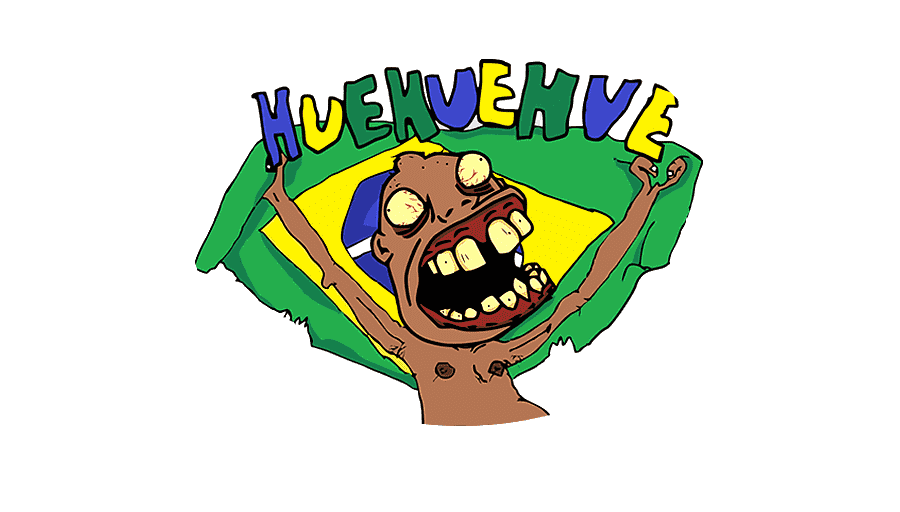

<h1 align="center">
  <br>
  <a>
  
</a>

  <br>
  <b>Hueshot</b>
  <br>
</h1>

<h4 align="center">The Legend of Zelda: Ocarina of Time (Nintendo Switch 2) running natively on Windows & Linux, with no emulator.
</h4>

<p align="center">
  <a href="#project-status">Status</a> |
  <a href="#install-and-play">Install and play</a> |
  <a href="#in-game-menu">In-game menu</a> |
  <a href="#if-something-goes-wrong">Problems</a> |
  <a href="#build-from-source">Build from source</a> |
  <a href="#how-it-works">How it works</a> |
  <a href="#want-to-help">Want to help?</a> |
  <a href="#credits">Credits</a> |
  <a href="#license">License</a>
</p>

Hueshot is a static recompilation. The game's code is translated to C and compiled into a Windows or Linux program,
the console's system software is reimplemented, and the Switch 2 graphics are rebuilt on Vulkan. All of this happens
**on your PC, from your own copy of the game**.
<br>

> [!NOTE]
> **Hueshot is a fork of [Hookshot](https://git.notrexed.dev/Hookshot/Hookshot).** NotRexed and its contributors made
> the original project; this fork continues it under the name Hueshot. This repository is
> [github.com/aismor/hueshot](https://github.com/aismor/hueshot); the original project's source, commits, issues and
> releases are at [git.notrexed.dev/Hookshot/Hookshot](https://git.notrexed.dev/Hookshot/Hookshot). Hueshot keeps
> Hookshot's GPL-3.0-or-later license and credits (see [Credits](#credits) and [License](#license)).

> [!WARNING]
> Some users report the file in releases to be a Trojan - it is not. Feel free to run it through any antivirus software

Discord (the Hookshot community): https://discord.gg/rexed
<br>

> [!IMPORTANT]
> This repository **does not contain the game, keys or an executable**, and it does not explain how to get them. You
> need your own copy. Everything the build creates (`hueshot.exe`, the generated code, the shader caches and your
> saves) comes from your game and stays on your PC. Never share those files.

## Project status

Experimental. Players have reported on many PCs, from Kokiri Forest to the dungeons: the table says what works and
what does not yet. Open problems are collected in tracking issues, linked below.

| What | Status |
|---|---|
| Kokiri Forest: reaching gameplay and walking around | ✅ Works |
| Sound, controller, keyboard and saves | ✅ Works |
| In-game menu, frame generation and upscaling | ✅ Works |
| Flicker (the picture flashing too bright while moving) | ✅ Fixed in v2.0.2 (#645) |
| Ground fog vanishing when looking down | ✅ Fixed in v2.0.2 (#638) |
| Models with missing pieces (doors, fences, parts of trees) | ✅ Fixed where tested, more play needed |
| Stutter when entering new areas | ⚠️ Still happens the first time you visit a place. The next visits are smooth |
| Performance | ⚠️ Depends on the PC: some reach a steady 60 fps, others stay below it, more so in Hyrule Field |
| Hyrule Field, Castle Town, Kakariko and the dungeons | ⚠️ Players got there, with open bugs: lighting and shadows (#1004), crashes and freezes (#2507) |
| Ultrawide and 4:3 | ✅ Works. The Aspect ratio row's default, Monitor's shape, widens the 3D to the screen and keeps the HUD and movies in the middle 16:9 ([#2119](https://git.notrexed.dev/Hookshot/Hookshot/commit/145eed2650d9d2cebad85a8a0052d302086015c7)) |
| NVIDIA cards | ✅ Works. The most tested |
| AMD cards | ⚠️ Many tested: reports from the RX 6600, RX 6800 XT, RX 7800 XT, RX 7900 XTX and RX 9070 XT. On Windows, the RX 6000 cards (Navi 21 and 22) draw task and mesh shaders through the compute fallback by default, as the driver lost the GPU with them (#1747, [#1992](https://git.notrexed.dev/Hookshot/Hookshot/commit/1396428d0bfcde68b5c7bd63f9837564d9af1a05), [#2215](https://git.notrexed.dev/Hookshot/Hookshot/commit/f95d80f5371821420c5a47a0c7e9f73e7f484abc)). Driver crashes and device lost are still reported ([#996](https://git.notrexed.dev/Hookshot/Hookshot/commit/f95d80f5371821420c5a47a0c7e9f73e7f484abc)) |
| Intel cards | ❓ Few reports, many of them black screens or crashes (#999) |
| Cards without mesh shaders (such as AMD RX 5000 and older) | ❌ Not supported: parts of the picture are missing. Since v2.0.6 a fallback runs the mesh programs as compute shaders on cards with buffer device addresses ([#640](https://git.notrexed.dev/Hookshot/Hookshot/commit/07773abd1dc7d79d56a690207e9bc7db7272076d)); it leaves out the mesh draws that take their count from a buffer |
| Linux | ✅ Works with the AppImage. Tested on several distributions (CachyOS, Fedora, Bazzite, SteamOS) and cards, with open problems on some AMD cards (#1000) |

## Install and play

The game does not come ready-made: Hueshot Builder builds it on your PC from your copy. You do this once. After that
you start the game from its launcher, which also updates it.

### What you need

- **Your copy of the game at the supported version:** program `0400486024DEC000`, update v131072, build `e0f3ccfa`.
  Other versions do not work. A `.nup` file, or the `romfs` and `exefs` folders.
- 64-bit Windows 10 or 11, or 64-bit Linux with glibc 2.35 or newer and a CPU with AVX2.
- A graphics card with Vulkan 1.3 and mesh shaders (NVIDIA RTX 20+, AMD RX 6000+, Intel Arc), with an up-to-date driver.
- 8 GB of video memory or more is recommended; 16 GB of RAM or more; about 60 GB free while building, on an SSD if you can.
- An internet connection for the download. Nothing else to install: the builder brings its own compiler and tools.

### On Windows

1. Open the [latest release](https://github.com/aismor/hueshot/releases/latest) and download `HueshotBuilder.exe`.
2. Run it. It downloads the rest of Hueshot Builder (about 500 MB), checks it, and opens it.
3. Pick your game (a `.nup` file, or the `romfs` and `exefs` folders). The builder checks the version.
4. Choose where to install it (`Games\Hueshot`) and the **Game language**.
5. Press **Build the game** (about 10 to 45 minutes), then **Play**.

Next time, start the game from the Hueshot shortcut, or `hueshot.exe` in the game folder. That is the launcher: it has
**Play**, and **Update** when a newer release is out. For a portable install, run the setup with `--portable` (see
[Portable Hueshot Builder](docs/windows-portable-builder.md)).

### On Linux

1. Open the [latest release](https://github.com/aismor/hueshot/releases/latest) and download
   `Hueshot-<version>-x86_64.AppImage`. It is Hueshot Builder with everything it needs inside.
2. Allow it to run as a program: right-click → **Properties** → "Allow executing file as program", or
   `chmod +x Hueshot-*-x86_64.AppImage`.
3. Double-click it. Under **Game files** choose **.nup file** or **romfs and exefs**, then **Browse** to pick them.
4. Under **Save the game to**, keep `~/Games/Hueshot` or choose another folder. Choose a **Language**.
5. Press **Build** (about 10 to 45 minutes), then **Play**.

The game is added to your applications menu as "Hueshot"; that entry, and `hueshot` in the game folder, open the
launcher. Keep the AppImage where it is: the launcher uses it to update. On Linux, fast GPU memory imports need read
access to `/dev/udmabuf` (see [If something goes wrong](docs/troubleshooting.md#linux-fast-gpu-memory-imports)).

### Updating

When a new release is out, the launcher says "Update available". Press **Update** (`hueshot.exe` on Windows, `hueshot`
or the AppImage on Linux). It downloads only the parts that changed and builds the game again in the same folder; your
saves and settings are kept. What changed is on the [Releases page](https://github.com/aismor/hueshot/releases).

### Latest development build

The [latest development build](https://github.com/aismor/hueshot/releases/tag/nightly) is made from `main` after every
change, with the same files as a release. It is untested and may break your saves: copy them first. On Windows, start
it as `HueshotBuilder.exe --tag nightly`; on Linux, use its AppImage. To go back, install the
[latest release](https://github.com/aismor/hueshot/releases/latest).

### Where the files go

- The build reads your game and never changes it. It writes to the folder you choose and to the builder's own folder:
  `%LOCALAPPDATA%\HueshotBuilder` on Windows, `~/.cache/hueshot-builder` on Linux.
- The build files (about 4 GB) are deleted once the game is ready; none are needed to play. Set
  `HUESHOT_KEEP_BUILD_FILES=1` to keep them so an update compiles only what changed.
- Saves: the `user` folder in the game folder on Windows, `~/.local/share/hueshot` on Linux. To carry on with a save
  from an emulator, see [using a save from an emulator](docs/saves.md).
- To uninstall, delete the game folder, the builder's folder and the shortcuts.

### What Hueshot connects to

Hueshot uploads nothing about you or your PC, and reads no browser data, passwords or session keys.

- **Downloads from GitHub only.** The builder and updater ask `api.github.com` which release is the latest and download
  that release's files from this repository. With **DLSS** ticked, NVIDIA's library comes from `github.com/NVIDIA/DLSS`.
  The game checks for a newer release at start; `HUESHOT_NO_UPDATE_CHECK=1` turns that off.
- **Your Discord status**, through the Discord app on this PC (the same local connection every game uses). Turn it off
  with **Gameplay → Discord status**.
- **Files it writes outside the game folder:** the builder's folder, its settings, the saves, and shortcuts if you ask
  for them. **Bug report** and **Save my pipeline list** only write files you choose to attach somewhere.

Only download Hueshot from this repository's [Releases](https://github.com/aismor/hueshot/releases). Each release
lists its files' checksums in `SHA256SUMS`.

### If something goes wrong

`hueshot_log.txt` in the game folder holds the last run. For a wrong texture, a crash, "device lost", a missing mesh
shader, stutter or a language question, see the [troubleshooting guide](docs/troubleshooting.md). If the problem
continues, [report it](https://github.com/aismor/hueshot/issues/new/choose) with the version, where you were, your
graphics card and the log. The in-game menu's **Gameplay → Bug report** gathers all of it in one press.

## In-game menu

Press <kbd>Insert</kbd>, <kbd>F1</kbd> or <kbd>Esc</kbd> in game (on a controller, Home or Select + Start). It has five
tabs — Graphics, Audio, Gameplay, Controls and Debug — and your choices are saved in `hueshot_options.ini`.

- **Good starting points**, and what each preset picks: [Settings](docs/graphics-and-controls.md).
- **Every option, choice and default, and the controls:** the [menu reference](docs/menu-reference.md).

## Mods

Put mods in a `mods` folder in the game folder (or point `HOS_MODS` at another folder), in the layout emulators use:
`mods/<name>/romfs/...`. Only RomFS mods are loaded; `exefs` patches need a rebuild. A folder whose name starts with
`-` or `_` is off, and when two mods have the same file the one whose folder name sorts last wins. A mod that makes
files bigger (HD textures) must ship the resource size table with its entries grown. The log names each mod loaded.

## Build from source

For developers, and for players who prefer the command line. The builder windows run the same script,
`nx2/make_game.py`:

```powershell
python -I nx2/make_game.py --nup "C:\path\your-game.nup" --out "C:\Games\Hueshot" --language en-US
python -I nx2/make_game.py --romfs "C:\path\romfs" --exefs "C:\path\exefs" --out "C:\Games\Hueshot" --language en-US
```

```sh
./Hueshot-<version>-x86_64.AppImage --cli --nup ~/your-game.nup --out ~/Games/Hueshot
```

Add `--check` to only check the game's version. Set `HUESHOT_JOBS=<n>` to limit how many files compile at once. The
full setup (Windows and Linux, llvm-mingw, the headers and the prebuilt tools) is in
[CONTRIBUTING.md](CONTRIBUTING.md), and the Linux AppImage is built with `scripts/linux/deps.sh` then
`scripts/linux/appimage.sh`.

### Running the game from the command line

The built game is `bin/hueshot.exe` on Windows and `bin/hueshot` in a packaged Linux game folder. To use these
arguments, start the game directly (not the launcher):

| Argument | What it does |
|---|---|
| `image.bin` | The game image to run. Without it the game uses the `image.bin`, `romfs` and `user` in its folder |
| `--romfs <folder>` | The extracted RomFS folder |
| `--user <folder>` | Where saves, caches and temp files go |
| `--trace` | Log every Horizon OS call (the same as `HOS_TRACE=1`) |
| `--prepare-shaders` | Prepare the shaders as the first start does, then exit |

For example, keep saves somewhere else: `bin\hueshot.exe --user "D:\Hueshot data"`.

### Upscaling: DLSS and FSR

The **Upscaler** row offers the game's own network and, in builds made with them, NVIDIA DLSS/DLAA, AMD FSR 3.1 and
AMD FSR 4. FSR 3.1 is in every build; DLSS and FSR 4 are optional and use NVIDIA's and AMD's own files under their
licenses. Details on each, and how to build with them: [Upscaling](docs/upscaling.md). Test switches
(`RX_VK_NOOPT=1` and the others) go in `hueshot_env.txt` in the game folder; the full list is in the
[development guide](docs/development.md#switches-for-testing-and-debugging).

## How it works

1. `nx2/lift.py` translates the game's ARM64 code to C.
2. `nx2/build.py` compiles that C together with `host/`, which plays the part of the console's system.
3. `host/nvn_native.c` records the game's NVN2 graphics calls, and `gpu/vk/` replays them on Vulkan.
4. Switch 2 Ampere shaders are lowered to Maxwell (`lower_to_maxwell.h`) and translated to SPIR-V by Eden's shader
   recompiler.

More detail is in the [development guide](docs/development.md) and the [design notes](docs/design.md).

## Want to help?

Testing on other graphics cards and reporting the result already helps a lot, and so does playing further into the
game than anyone has yet.

### Send your pipeline list

The first time the game meets a pipeline it builds it on the spot, which stutters. Releases build a list of known
pipelines before the title, and every player's play adds to it. To send yours: in the game's Debug tab (or the
builder's launcher page), press **Save my pipeline list**. It saves `hueshot-pipelines-<date>.zip` in Downloads, copies
a filled-in report to the clipboard and opens the Pipelines form in your browser; attach the zip and paste the report.
The zip holds only shader hashes and draw state — no game code, game data or personal info — and nothing is uploaded
for you.

Bigger ways to help: **Linux testing** (reports from other distributions and cards still help), and **fixes in your
own fork**. [CONTRIBUTING.md](CONTRIBUTING.md) has the setup, the test commands and what a good pull request looks like.

## Credits

Hueshot exists thanks to the work of many people. It is a fork of **Hookshot**, by NotRexed and its contributors, at
[git.notrexed.dev/Hookshot/Hookshot](https://git.notrexed.dev/Hookshot/Hookshot):

- **NotRexed**: Hookshot (the project Hueshot forks), BlueShell (Mario Kart World), Skybound (Tears of the Kingdom)
  and the a64-kit tools.
- **aismor**: the Hueshot fork, its releases and maintenance.
- **[Eden](https://git.eden-emu.dev/eden-emu/eden)** and **Eglantine**: the shader recompiler and Switch 2 shader work.
- **suyu**: the graphics decoders and the AArch64 translator.
- **[seedds/nxnative](https://github.com/seedds/nxnative)**: reference for how task and mesh shaders work.
- **[EvilBoyce / evilmfkr](https://github.com/evilmfkr/Hookshot)** (EvilOOT): the GPU culling that brings back Kokiri's foliage
  (trees, ferns, grass, falling leaves, fireflies), the ambient light probes, the pond's water, the game's own fog, the freeze
  after Load (Horizon's mutex handoff) and the exposure flicker fix.
- **[zortos293/Lichii](https://github.com/zortos293/Lichii)**: reference for Ampere shader lowering, and its compare-exchange retry fix.
- **[mstorsjo/llvm-mingw](https://github.com/mstorsjo/llvm-mingw)**: the bundled Windows compiler (no Visual Studio needed).
- **NVIDIA DLSS**: builds made with NVIDIA's DLSS SDK (optional, downloaded by each build, never bundled) use NVIDIA DLSS
  Super Resolution, NVIDIA's technology. NVIDIA and DLSS are trademarks of NVIDIA Corporation.
- **AMD FSR 3.1 and FSR 4**: every build has AMD FidelityFX Super Resolution 3.1, built from AMD's MIT-licensed FidelityFX
  SDK shaders; builds made with FSR 4 (optional; AMD's DLLs are never bundled) use AMD FidelityFX Super Resolution 4
  through AMD's MIT-licensed FSR API headers. Both are AMD's technology. AMD, Radeon and FidelityFX are trademarks of Advanced Micro
  Devices, Inc.
  **Longshot**: Fork of Hookshot, for some bug fixes and launcher additions
- **[kinnay/zbic](https://github.com/kinnay/zbic)**, **Opus** and **SDL**: decompression, audio and controllers.
- **[sostenesfreitas/ocarina-recomp](https://github.com/sostenesfreitas/ocarina-recomp)**: this README's layout, and its notes
  confirmed the mesh stage's control section.
- **[MythosOfs/Orchid](https://github.com/MythosOfs/Orchid)**: the fog and exposure workaround Ocarina of Time used before
  its fog and lighting were fixed.
- **Mesa (NAK)**: the reference for Ampere's instruction encoding.
- Everyone who sent fixes: SkippySteve (Linux and the AppImage, and many more), monsterlag, klimovich008, hckrman101 (NVIDIA
  DLSS, DLAA and Reflex, the exposure flicker and fog fixes, build speed, CI), madebyjordan (AMD FSR 4.1), N3oTraX (FSR 4 on
  Linux), shayderrr, gab9281, Wpaif, nicholasgower, ZurielAtr, Joey-Magnus, Zorkats,
  d3zessete, chrispository, vzeol, leonidasmark, Segmentree, ShyVortex, hiKareeem and i900gaming, among others.

## License

Hueshot is a fork of [Hookshot](https://git.notrexed.dev/Hookshot/Hookshot), and both are free software under the
[GNU General Public License, version 3 or later](LICENSE) (GPL-3.0-or-later). Hueshot keeps the original project's
license and notices; the original source and history are at
[git.notrexed.dev/Hookshot/Hookshot](https://git.notrexed.dev/Hookshot/Hookshot), and this fork is at
[github.com/aismor/hueshot](https://github.com/aismor/hueshot).
It includes code from Eden and suyu, which are under the GPL too. Third-party parts under other licenses that
work with the GPL (Sirit, the Vulkan Memory Allocator, SDL, Opus, Dear ImGui, zstd, the Libertinus fonts, zbic and the
a64-kit tools) keep their own notices in their folders.

Hueshot is an unofficial fan project, not affiliated with or endorsed by Nintendo. The Legend of Zelda and Ocarina of
Time are trademarks of Nintendo.
